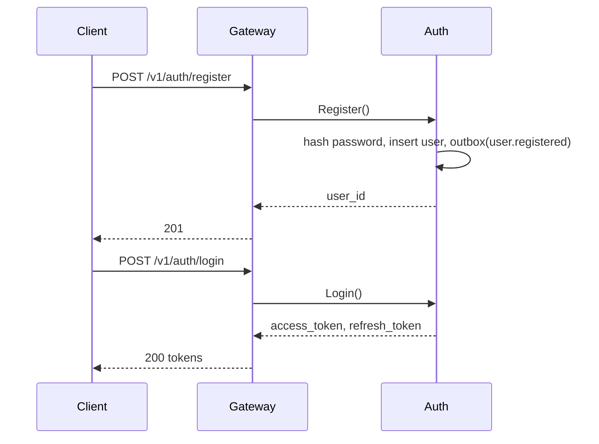
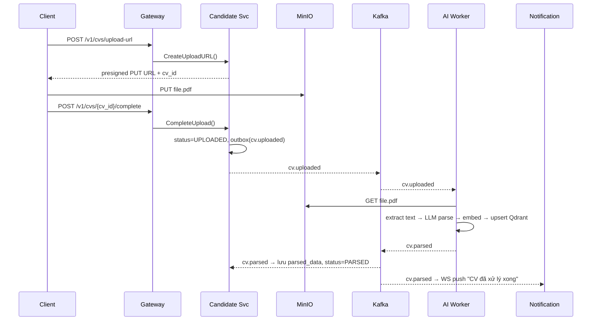
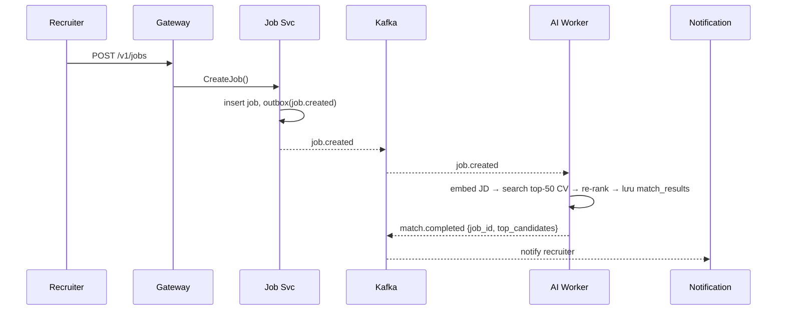
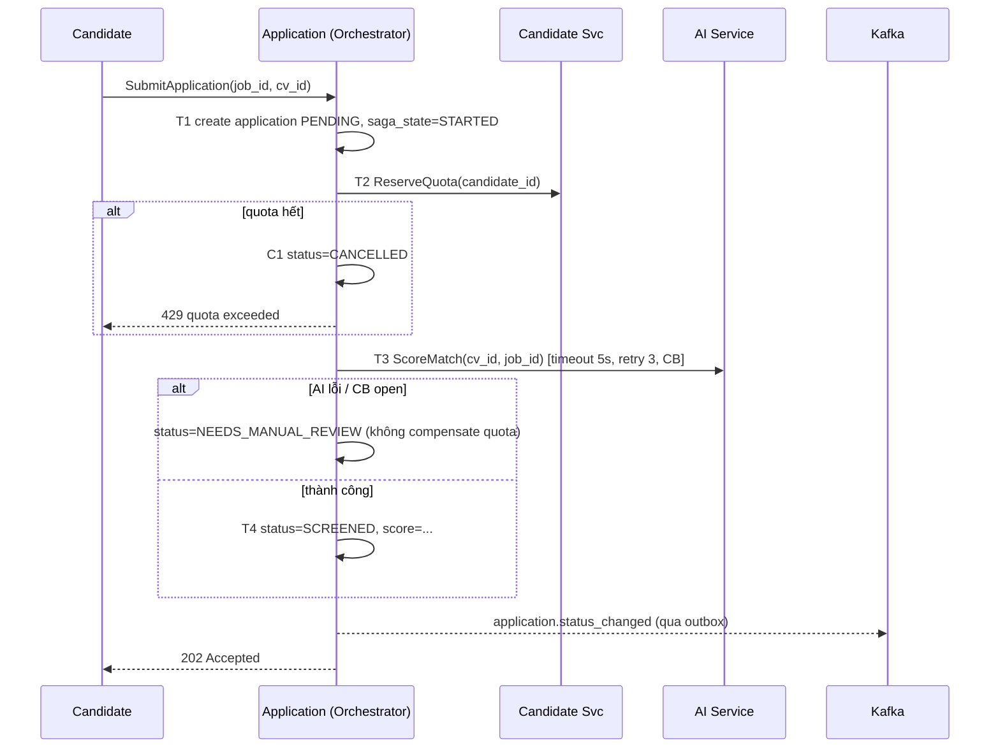
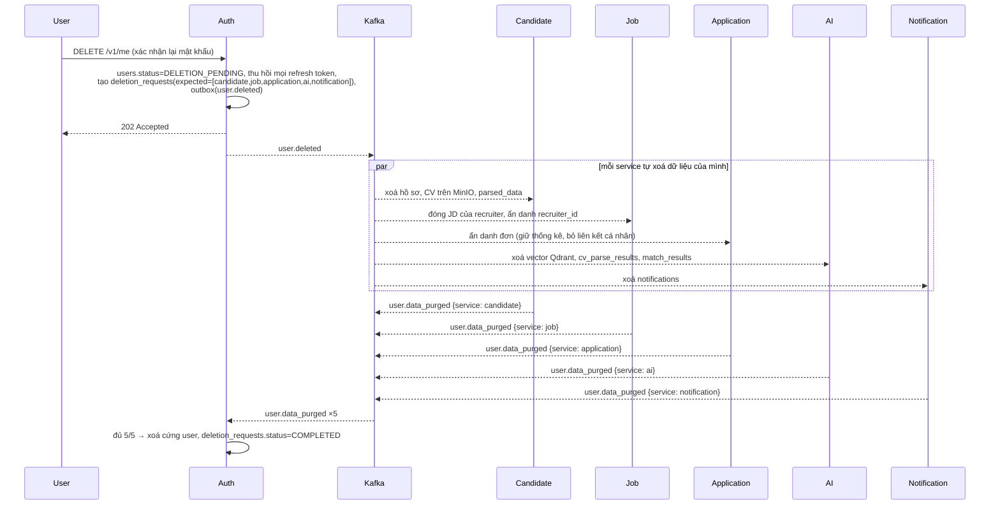
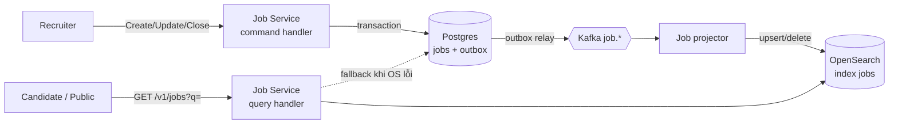
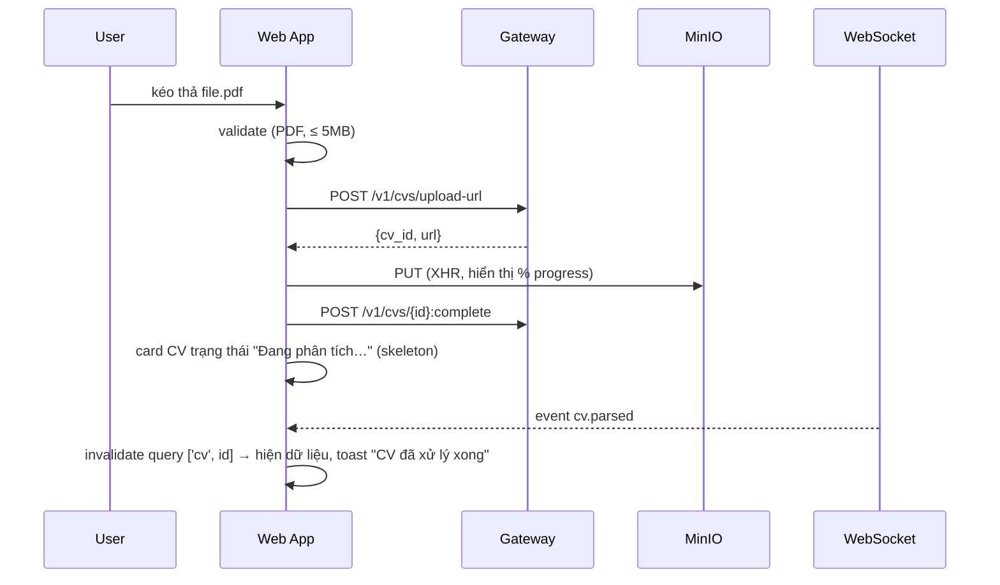

# SmartHire — Technical Specification

> Nền tảng tuyển dụng full-stack: Web App (Next.js) + microservice backend (Go) + AI Service (Python) để trích xuất CV, ghép CV–JD và chấm điểm ứng viên.

| Mục | Giá trị |
|---|---|
| Phiên bản spec | 0.3.0 (draft) — bổ sung Frontend, CQRS tìm kiếm JD, saga xoá tài khoản, pattern catalog |
| Ngày | 2026-11-08 |
| Tác giả | Như Văn Hùng |
| Trạng thái | Draft — dùng cho MVP |

---

## Mục lục

1. [Tổng quan](#1-tổng-quan)
2. [Phạm vi](#2-phạm-vi)
3. [Actors & Use cases](#3-actors--use-cases)
4. [Kiến trúc tổng thể](#4-kiến-trúc-tổng-thể)
5. [Đặc tả từng service](#5-đặc-tả-từng-service)
6. [Workflow chính](#6-workflow-chính)
7. [Event catalog](#7-event-catalog)
8. [Data model](#8-data-model)
9. [Tech stack](#9-tech-stack)
10. [Cấu trúc thư mục](#10-cấu-trúc-thư-mục)
11. [Kiến trúc code bên trong service](#11-kiến-trúc-code-bên-trong-service)
12. [Frontend (Web App)](#12-frontend-web-app)
13. [API contracts](#13-api-contracts)
14. [Non-functional requirements](#14-non-functional-requirements)
15. [Cấu hình & secrets](#15-cấu-hình--secrets)
16. [Local development](#16-local-development)
17. [Testing strategy](#17-testing-strategy)
18. [CI/CD & Deployment](#18-cicd--deployment)
19. [Conventions](#19-conventions)
20. [Roadmap](#20-roadmap)
21. [Rủi ro & quyết định mở](#21-rủi-ro--quyết-định-mở)

---

## 1. Tổng quan

### 1.1 Bài toán
Nhà tuyển dụng nhận hàng trăm CV cho mỗi vị trí và phải sàng lọc thủ công. Ứng viên không biết mình phù hợp với vị trí nào.

### 1.2 Giải pháp
SmartHire cho phép:
- **Ứng viên** upload CV (PDF). Hệ thống tự trích xuất thông tin có cấu trúc và gợi ý việc làm phù hợp.
- **Nhà tuyển dụng** đăng JD. Hệ thống tự tìm và xếp hạng ứng viên phù hợp, kèm giải thích điểm số.
- **Quy trình nộp đơn** được theo dõi trạng thái end-to-end.

### 1.3 Mục tiêu kỹ thuật
- Thực hành kiến trúc microservice chuẩn production: database-per-service, giao tiếp sync (gRPC) và async (Kafka), Saga, Outbox, observability.
- Tích hợp AI service (Python) vào hệ sinh thái Go một cách resilient: AI chậm hoặc lỗi không được kéo sập hệ thống.

---

## 2. Phạm vi

### 2.1 MVP (in scope)
- Auth: đăng ký, đăng nhập, JWT, RBAC (`candidate`, `recruiter`, `admin`).
- Job: CRUD JD, tìm kiếm full-text, lọc theo kỹ năng/địa điểm/level.
- Candidate: hồ sơ, upload CV lên object storage.
- AI: parse CV → JSON, embedding CV và JD, vector search top-K, chấm điểm match.
- Application: nộp đơn, state machine trạng thái, Saga orchestration.
- Notification: email (SMTP/Mailpit), WebSocket realtime.
- **Web App (Next.js)**: landing page công khai, portal ứng viên, portal nhà tuyển dụng, trang admin; responsive (desktop + mobile web); song ngữ vi/en; dark mode.
- Observability: logs, metrics, traces.
- Docker Compose cho local, Helm chart cho K8s.

### 2.2 Ngoài phạm vi (phase sau)
- Giải thích match bằng LLM (natural language explanation) — phase 2.
- Lên lịch phỏng vấn, tích hợp calendar.
- Thanh toán / gói dịch vụ cho recruiter.
- Multi-tenant cho nhiều công ty.
- Fine-tune model riêng.

---

## 3. Actors & Use cases

| Actor | Use case |
|---|---|
| Candidate | Đăng ký / đăng nhập; cập nhật hồ sơ; upload CV; xem CV đã parse; xem job gợi ý; nộp đơn; theo dõi trạng thái đơn |
| Recruiter | Đăng / sửa / đóng JD; xem danh sách ứng viên gợi ý (xếp hạng); xem đơn nộp; chuyển trạng thái đơn |
| Admin | Quản lý user; xem dashboard hệ thống; duyệt JD vi phạm |
| System | Parse CV bất đồng bộ; chạy matching khi có JD/CV mới; gửi thông báo |

---

## 4. Kiến trúc tổng thể

```mermaid
flowchart LR
    User[Browser] -->|HTTPS| WEB[Web App<br/>Next.js SSR/RSC]
    User -->|REST + WS<br/>từ client components| GW
    WEB -->|REST server-side| GW[API Gateway<br/>Go]
    User -->|PUT CV presigned| S3

    GW -->|gRPC| AUTH[Auth Service<br/>Go]
    GW -->|gRPC| JOB[Job Service<br/>Go]
    GW -->|gRPC| CAND[Candidate Service<br/>Go]
    GW -->|gRPC| APP[Application Service<br/>Go + Saga Orchestrator]
    GW -->|WS proxy| NOTI[Notification Service<br/>Go]

    APP -->|gRPC| AI[AI Service<br/>Python]
    JOB -->|gRPC| AI

    AUTH --- PGA[(Postgres auth)]
    JOB --- PGJ[(Postgres job<br/>write model)]
    JOB --- OS[(OpenSearch<br/>read model)]
    CAND --- PGC[(Postgres candidate)]
    CAND --- S3[(MinIO / S3)]
    APP --- PGP[(Postgres application)]
    AI --- QD[(Qdrant)]
    AI --- PGAI[(Postgres ai)]
    GW --- RD[(Redis)]

    JOB -. events .-> K{{Kafka}}
    CAND -. events .-> K
    APP -. events .-> K
    AI -. events .-> K
    K -. events .-> NOTI
    K -. events .-> AI
    K -. events .-> APP
    K -. job.* .-> JOB
    K -. user.deleted .-> CAND
    K -. user.deleted .-> AUTH
```

### 4.1 Nguyên tắc kiến trúc
1. **Database-per-service**: không service nào đọc DB của service khác.
2. **Sync khi cần kết quả ngay** (gRPC), **async khi xử lý lâu hoặc fan-out** (Kafka).
3. **AI Service là phụ thuộc "mềm"**: mọi lời gọi tới AI đều có timeout, retry và circuit breaker; lỗi AI không chặn luồng chính.
4. **Event là nguồn sự thật cho tích hợp**: publish qua Transactional Outbox.
5. **Stateless services**: scale ngang được; state nằm ở DB/Redis/Kafka.
6. **Chỉ dùng Saga khi thật sự cần** (xem 6.6); mặc định dùng Outbox + idempotent consumer để đạt eventual consistency.
7. **Tách đọc/ghi (CQRS) chỉ nơi có lợi rõ ràng**: tìm kiếm JD (xem 6.7).

### 4.2 Database-per-service — mức độ tách

"Riêng" nghĩa là **riêng quyền sở hữu dữ liệu**: service A không bao giờ query thẳng DB của service B. Muốn dùng dữ liệu của service khác thì gọi gRPC (cần kết quả ngay) hoặc nghe event và lưu bản sao cục bộ (đọc thường xuyên).

| Service | Lưu trữ sở hữu |
|---|---|
| Gateway | Redis (rate limit, idempotency key, cache) — không có DB nghiệp vụ |
| Auth | `auth_db` |
| Job | `job_db` (write model) + index OpenSearch `jobs` (read model) |
| Candidate | `candidate_db` + bucket MinIO `cvs` |
| Application | `application_db` |
| Notification | `notification_db` |
| AI | `ai_db` + Qdrant |
| Web App | không có — chỉ gọi API |

| Mức | Cách tách | Dùng khi |
|---|---|---|
| 1 | Một Postgres instance, mỗi service một database + user riêng (user `job_svc` chỉ có quyền trên `job_db`) | Local, MVP — **mức hiện tại** |
| 2 | Nhiều instance trong một cluster | Service tải nặng cần cô lập hiệu năng |
| 3 | Mỗi service một cluster riêng | Production quy mô lớn |

Kafka, Redis, MinIO dùng chung hạ tầng nhưng phân vùng: topic theo domain, key prefix `<service>:`, bucket riêng; mỗi service có credential riêng với quyền tối thiểu.

### 4.3 Pattern catalog

| Nhóm | Pattern | Áp dụng ở đâu |
|---|---|---|
| Kiến trúc | Microservices, Database-per-service | 4.2 |
| | API Gateway | 5.1 |
| | Event-driven / Pub-Sub | 7 |
| | Shared contracts (proto, JSON Schema) | `contracts/` |
| Nhất quán dữ liệu | **Saga — orchestration** | Nộp đơn (6.4) |
| | **Saga — choreography** | Xoá tài khoản (6.5) |
| | Transactional Outbox | Mọi service phát event (14.3) |
| | Idempotent Consumer | Bảng `processed_events` |
| | Idempotency Key | `POST /v1/applications` |
| | State Machine | Đơn (5.5), CV, JD, saga |
| | Local data replica qua event | AI lưu embedding JD/CV |
| Đọc/ghi | **CQRS + Projection** | Tìm kiếm JD qua OpenSearch (6.7) |
| | Cache-aside | Redis cho `FindCandidates` |
| Resilience | Circuit Breaker | Application → AI |
| | Retry + exponential backoff + jitter | gRPC, consumer |
| | Timeout | Mọi lời gọi gRPC |
| | Bulkhead | AI `api` / `worker` tách deployment |
| | Fallback / graceful degradation | `NEEDS_MANUAL_REVIEW`; search fallback Postgres |
| | Dead Letter Queue | `<topic>.dlq` |
| | Graceful Shutdown | Mọi service (11) |
| Giao tiếp | Async Request-Reply | `202` + kết quả qua WebSocket |
| | Competing Consumers | AI worker, projector |
| | Valet Key (presigned URL) | Upload CV |
| | Cursor pagination | API danh sách |
| Trong service | Hexagonal / Ports & Adapters | 11 |
| | Repository, constructor DI | `adapter/`, `bootstrap/` |
| Bảo mật | Token rotation + reuse detection | Refresh token |
| | Short-lived ticket | WebSocket |
| Vận hành | Health Check API, Distributed Tracing, Externalized Config, GitOps | 14.5, 15, 18 |
| Frontend | Optimistic UI, SSR + hydration | 12.3, 12.5 |

**Cố ý không dùng** (ghi trong ADR): Event Sourcing (quá nặng cho MVP, `application_history` đủ cho audit), BFF riêng (Next.js server components đã đảm nhận), 2PC/XA (khoá tài nguyên, không hợp microservice).

---

## 5. Đặc tả từng service

### 5.1 API Gateway (Go)
- **Trách nhiệm**: entrypoint duy nhất; REST → gRPC translation; verify JWT; rate limit (Redis token bucket); CORS (chỉ cho origin của Web App, `credentials: include`); set/clear cookie refresh token; cấp WS ticket; request ID; proxy WebSocket.
- **Không** chứa business logic.
- **Port**: `8080` (HTTP).

### 5.2 Auth Service (Go)
- **Trách nhiệm**: user, credentials (bcrypt/argon2id), cấp access token (15 phút) + refresh token (7 ngày, rotate, phát hiện reuse → thu hồi cả chuỗi), RBAC; endpoint JWKS cho Gateway.
- **DB**: `auth_db` — bảng `users`, `refresh_tokens`.
- **Events phát**: `user.registered`.
- **Port**: gRPC `9001`.

### 5.3 Job Service (Go)
- **Trách nhiệm**: CRUD JD, trạng thái JD (`draft` → `open` → `closed`), tìm kiếm JD theo **CQRS** (6.7).
- **Hai process**:
  - `server` (command + query API): ghi Postgres (write model); đọc tìm kiếm từ OpenSearch (read model).
  - `projector`: consume `job.*` → cập nhật index OpenSearch `jobs`.
- **Gọi sync**: `AIService.FindCandidates(job_id, top_k)` khi recruiter mở trang "ứng viên gợi ý".
- **Events phát**: `job.created`, `job.updated`, `job.closed`, `job.deleted`.
- **Events nghe**: `job.*` (projector), `user.deleted` (recruiter bị xoá → đóng JD, ẩn danh).
- **Port**: gRPC `9002`.

### 5.4 Candidate Service (Go)
- **Trách nhiệm**: hồ sơ ứng viên; upload CV qua **presigned URL** (client upload thẳng lên MinIO); lưu metadata CV; lưu kết quả parse nhận từ AI.
- **Events phát**: `cv.uploaded`.
- **Events nghe**: `cv.parsed`, `cv.parse_failed`.
- **Port**: gRPC `9003`.

### 5.5 Application Service (Go)
- **Trách nhiệm**: nộp đơn, state machine đơn, **Saga orchestrator** cho luồng nộp đơn, quota nộp đơn/ngày.
- **State machine**:
  ```
  PENDING → SCREENING → SCREENED → INTERVIEW → OFFERED → HIRED
      │          │           └────────→ REJECTED
      │          └→ NEEDS_MANUAL_REVIEW (AI lỗi)
      └→ CANCELLED (compensation)
  ```
- **Events phát**: `application.submitted`, `application.status_changed`.
- **Port**: gRPC `9004`.

### 5.6 Notification Service (Go)
- **Trách nhiệm**: consume event → gửi email (template) và push WebSocket; lưu lịch sử thông báo; dedupe theo `event_id`.
- **Events nghe**: `match.completed`, `application.status_changed`, `cv.parsed`, `user.registered`.
- **Port**: HTTP/WS `8085`.

### 5.7 AI Service (Python)
- **Trách nhiệm**:
  1. **CV parsing**: PDF → text (PyMuPDF) → JSON có cấu trúc (LLM với structured output, fallback rule/NER).
  2. **Embedding**: CV và JD → vector (`BAAI/bge-m3`, hỗ trợ tiếng Việt), lưu Qdrant.
  3. **Matching**: vector search top-K, sau đó re-rank bằng điểm tổng hợp.
  4. **Scoring**: trả về `score` 0–100 và `breakdown`.
- **Công thức điểm (MVP)**:
  ```
  score = 100 × ( 0.55 × semantic_sim
                + 0.30 × required_skill_coverage
                + 0.10 × experience_fit
                + 0.05 × location_fit )
  Nếu thiếu > 50% kỹ năng bắt buộc → score = min(score, 40)
  ```
- **Interface**: gRPC server (`grpcio`, port `9100`) + Kafka consumer (worker riêng) + FastAPI `/healthz`, `/metrics` (port `8100`).
- **Events nghe**: `cv.uploaded`, `job.created`, `job.updated`.
- **Events phát**: `cv.parsed`, `cv.parse_failed`, `match.completed`.
- **Tách process**: `api` (gRPC, latency thấp) và `worker` (Kafka consumer, batch nặng) để scale độc lập.

---

## 6. Workflow chính

### 6.1 Đăng ký & đăng nhập


### 6.2 Upload CV → Parse (async)

- **Lỗi parse**: retry 3 lần (exponential backoff), sau đó đẩy vào `cv.uploaded.dlq` và phát `cv.parse_failed`.

### 6.3 Đăng JD → Matching

- Khi recruiter mở trang ứng viên gợi ý: `Job Svc → AI.FindCandidates()` (sync, đọc kết quả đã tính, có cache Redis 5 phút).

### 6.4 Nộp đơn — Saga (orchestration)


| Bước | Hành động | Compensation |
|---|---|---|
| T1 | Tạo application `PENDING` | `CANCELLED` |
| T2 | Reserve quota | `ReleaseQuota` |
| T3 | AI chấm điểm | — (fallback `NEEDS_MANUAL_REVIEW`) |
| T4 | Cập nhật `SCREENED` + score | — |
| T5 | Publish event | — (outbox đảm bảo) |

- Trạng thái saga lưu ở bảng `saga_instances`; có job **recovery** quét saga treo quá 10 phút để tiếp tục hoặc compensate.
- **Phase 2**: cân nhắc chuyển sang **Temporal** (SDK Go + Python).
- **Ghi chú thiết kế**: nếu chuyển quota nộp đơn từ Candidate sang Application thì T1 + T2 nằm chung một transaction cục bộ, saga gọn hơn. Giữ nguyên thiết kế hiện tại để minh hoạ compensation; ghi lựa chọn này trong ADR về saga orchestration.

### 6.5 Xoá tài khoản — Saga (choreography)

Yêu cầu theo Nghị định 13/2023/NĐ-CP: người dùng có quyền xoá dữ liệu cá nhân; hệ thống phải xoá ở **mọi** service và chứng minh được đã xoá.



- **Choreography** vì các bước **độc lập, không thứ tự, không cần compensation**: xoá chỉ có chiều đi tới, mỗi service tự retry đến khi xong.
- Auth giữ bảng `deletion_requests` làm **tracker** (không ra lệnh, chỉ thu thập `user.data_purged`).
- Xử lý idempotent: nhận `user.deleted` lần hai thì vẫn phát lại `user.data_purged`.
- Quá 24h chưa đủ xác nhận → alert + runbook `docs/runbooks/account-deletion-stuck.md`.
- Trong thời gian `DELETION_PENDING`: không đăng nhập được; Gateway từ chối mọi token của user (kiểm tra denylist trên Redis).

### 6.6 Khi nào dùng Saga — tiêu chí

Câu hỏi quyết định: **một thao tác nghiệp vụ có ghi vào nhiều service, và nếu bước sau thất bại thì có phải hoàn tác bước trước không?**

| Luồng | Cơ chế | Lý do |
|---|---|---|
| Nộp đơn | **Saga orchestration** | Ghi Application + Candidate (quota); lỗi thì phải hoàn quota/huỷ đơn; nhiều bước, cần một nơi quản lý trạng thái |
| Xoá tài khoản | **Saga choreography** | Ghi ở 5 service, bước độc lập, chỉ cần đảm bảo tất cả hoàn tất |
| Upload CV → parse | Outbox + idempotent consumer | Một chiều; lỗi thì `FAILED` + cho thử lại, không có gì để hoàn tác |
| Đăng JD → matching | Outbox + idempotent consumer | Matching là kết quả phụ, chạy lại được |
| Đổi trạng thái đơn → thông báo | Outbox + retry | Thông báo là hệ quả, không ảnh hưởng tính đúng của đơn |
| Đồng bộ read model tìm kiếm | Projection (6.7) | Read model có thể rebuild bất cứ lúc nào từ write model |
| Đăng ký, CRUD JD, hồ sơ | Transaction cục bộ | Chỉ ghi vào một service |

**Quy tắc**: ưu tiên vẽ lại ranh giới service để thao tác nằm trong một DB; chỉ khi không thể mới dùng Saga. Chọn **orchestration** khi có ≥ 3 bước phụ thuộc hoặc cần compensation; **choreography** khi các bước độc lập và chỉ đi tới.

### 6.7 Tìm kiếm JD — CQRS

**Vấn đề**: tìm kiếm JD là luồng đọc nhiều nhất (trang công khai, SEO), cần full-text tiếng Việt có dấu/không dấu, fuzzy, facet (đếm theo kỹ năng, địa điểm, level), sắp xếp theo độ liên quan. Postgres `tsvector` làm được mức cơ bản nhưng yếu ở tiếng Việt và facet, đồng thời tải đọc tranh chấp với tải ghi.

**Giải pháp**: tách **write model** (Postgres, chuẩn hoá, ràng buộc toàn vẹn) và **read model** (OpenSearch, denormalized, tối ưu tìm kiếm).



- **Command** (`CreateJob`, `UpdateJob`, `CloseJob`) chỉ ghi Postgres + outbox.
- **Query** `SearchJobs` đọc OpenSearch; `GetJob(id)` đọc Postgres (cần dữ liệu mới nhất cho chủ JD).
- **Projector** idempotent: upsert theo `job_id`, chỉ ghi nếu `event.version > doc.version` (chống event đến sai thứ tự).
- **Eventual consistency**: JD mới xuất hiện trong kết quả tìm kiếm sau ~1–2s. FE sau khi recruiter tạo JD thì điều hướng sang trang chi tiết (đọc Postgres), không sang trang search.
- **Rebuild**: lệnh `job-projector rebuild` đọc toàn bộ Postgres → index mới `jobs_v{n}` → đổi alias `jobs` (zero-downtime). Dùng khi đổi mapping/analyzer.
- **Fallback**: OpenSearch lỗi hoặc circuit breaker mở → query Postgres `tsvector` (kết quả kém hơn nhưng vẫn phục vụ được).
- **Tiếng Việt**: analyzer gồm `icu_tokenizer` + `icu_folding` (bỏ dấu) + field `.raw` giữ dấu để boost khớp chính xác; synonym cho kỹ năng (`golang ⇔ go`, `k8s ⇔ kubernetes`).

---

## 7. Event catalog

### 7.1 Envelope chuẩn (CloudEvents-style, JSON)
```json
{
  "event_id": "01JC8Z...ULID",
  "event_type": "cv.parsed",
  "event_version": 1,
  "source": "ai-service",
  "occurred_at": "2026-11-08T16:00:00Z",
  "trace_id": "4bf92f3577b34da6a3ce929d0e0e4736",
  "correlation_id": "req-...",
  "payload": { }
}
```

### 7.2 Topics

| Topic | Producer | Consumers | Key | Payload chính |
|---|---|---|---|---|
| `user.registered` | auth | notification | `user_id` | `user_id, email, role` |
| `user.deleted` | auth | candidate, job, application, ai, notification | `user_id` | `user_id, role, requested_at, deletion_request_id` |
| `user.data_purged` | candidate, job, application, ai, notification | auth | `user_id` | `user_id, service, deletion_request_id, purged_at` |
| `job.created` | job | ai, notification, job-projector | `job_id` | `job_id, title, description, required_skills[], level, location` |
| `job.updated` | job | ai, job-projector | `job_id` | như trên + `version` |
| `job.closed` | job | ai, application, job-projector | `job_id` | `job_id, version` |
| `job.deleted` | job | ai, job-projector | `job_id` | `job_id, version` |
| `cv.uploaded` | candidate | ai | `cv_id` | `cv_id, candidate_id, object_key` |
| `cv.parsed` | ai | candidate, notification | `cv_id` | `cv_id, parsed{skills[], years_exp, education[], ...}` |
| `cv.parse_failed` | ai | candidate, notification | `cv_id` | `cv_id, reason` |
| `match.completed` | ai | notification | `job_id` | `job_id, top[{candidate_id, cv_id, score}]` |
| `application.submitted` | application | notification | `application_id` | `application_id, job_id, candidate_id` |
| `application.status_changed` | application | notification | `application_id` | `application_id, from, to, score?` |

- **Partitioning**: key theo entity ID để đảm bảo thứ tự trong cùng entity.
- **DLQ**: mỗi topic consumer có `<topic>.dlq`.
- **Schema versioning**: trường `event_version`; thay đổi breaking thì tạo version mới, consumer hỗ trợ song song 2 version. Schema JSON lưu ở `contracts/events/`.

---

## 8. Data model

### 8.1 auth_db
```sql
users(id UUID PK, email CITEXT UNIQUE, password_hash TEXT, role TEXT, created_at, updated_at)
refresh_tokens(id UUID PK, user_id UUID FK, token_hash TEXT, expires_at, revoked_at)
-- users.status: ACTIVE | LOCKED | DELETION_PENDING
deletion_requests(id UUID PK, user_id UUID, status TEXT,        -- PENDING | COMPLETED | STUCK
                  expected_services TEXT[], purged_services TEXT[], requested_at, completed_at)
processed_events(event_id TEXT PK, processed_at)
outbox(id UUID PK, aggregate_id, event_type, payload JSONB, created_at, published_at NULL)
```

### 8.2 job_db
```sql
jobs(id UUID PK, recruiter_id UUID, title, description TEXT, required_skills TEXT[],
     nice_to_have_skills TEXT[], level TEXT, location TEXT, salary_min INT, salary_max INT,
     status TEXT, version BIGINT, search_vector TSVECTOR,   -- tsvector giữ cho fallback
     created_at, updated_at)
processed_events(...), outbox(...)
```

**Read model — OpenSearch index `jobs` (alias → `jobs_v1`)**
```json
{
  "job_id": "keyword", "version": "long",
  "title": "text (vi_analyzer) + .raw keyword",
  "description": "text (vi_analyzer)",
  "required_skills": "keyword", "nice_to_have_skills": "keyword",
  "level": "keyword", "location": "keyword",
  "salary_min": "integer", "salary_max": "integer",
  "company_name": "text + keyword",
  "status": "keyword", "published_at": "date"
}
```
Chỉ index JD `status=open`; `job.closed`/`job.deleted` → xoá document.

### 8.3 candidate_db
```sql
candidates(id UUID PK, user_id UUID UNIQUE, full_name, phone, location, created_at, updated_at)
cvs(id UUID PK, candidate_id UUID FK, object_key TEXT, status TEXT  -- UPLOADING|UPLOADED|PARSED|FAILED
    , parsed_data JSONB, parsed_at, created_at)
daily_quota(candidate_id UUID, date DATE, used INT, PRIMARY KEY(candidate_id, date))
processed_events(event_id TEXT PK, processed_at)   -- idempotency
outbox(...)
```

### 8.4 application_db
```sql
applications(id UUID PK, job_id UUID, candidate_id UUID, cv_id UUID, status TEXT,
             score NUMERIC(5,2), score_breakdown JSONB, created_at, updated_at,
             UNIQUE(job_id, candidate_id))
application_history(id BIGSERIAL PK, application_id UUID, from_status, to_status, actor, at)
saga_instances(id UUID PK, application_id UUID, step TEXT, state TEXT, payload JSONB,
               retries INT, updated_at)
processed_events(...), outbox(...)
```

### 8.5 ai_db + Qdrant
```sql
cv_parse_results(cv_id UUID PK, raw_text TEXT, parsed JSONB, model_version TEXT, created_at)
match_results(job_id UUID, cv_id UUID, candidate_id UUID, score NUMERIC, breakdown JSONB,
              model_version TEXT, computed_at, PRIMARY KEY(job_id, cv_id))
processed_events(...)
```
- **Qdrant collections**: `cv_embeddings` (payload: `cv_id, candidate_id, skills, years_exp, location`), `job_embeddings`. Dim = 1024 (bge-m3), cosine.

### 8.6 notification_db
```sql
notifications(id UUID PK, user_id UUID, type TEXT, title, body, read_at, created_at)
processed_events(...)
```

---

## 9. Tech stack

### 9.1 Backend Go
| Hạng mục | Lựa chọn | Ghi chú |
|---|---|---|
| Ngôn ngữ | Go 1.23+ | Go workspace (`go.work`) cho monorepo |
| HTTP (Gateway) | `chi` hoặc `grpc-gateway` | grpc-gateway sinh REST từ proto |
| RPC | gRPC + Protobuf, `buf` | lint, breaking-change check, codegen |
| DB driver | `pgx/v5` | |
| Query | `sqlc` | type-safe SQL, không ORM |
| Migration | `golang-migrate` hoặc `goose` | |
| Kafka | `franz-go` | |
| Config | `koanf` hoặc `envconfig` | 12-factor, đọc từ env |
| Logging | `log/slog` (JSON) | |
| Validation | `protovalidate` | |
| Resilience | `sony/gobreaker`, `cenkalti/backoff` | |
| Auth | `golang-jwt/jwt/v5` | RS256 |
| Test | `testify`, `testcontainers-go`, `gomock` | |
| Lint | `golangci-lint` | |

### 9.2 AI Service Python
| Hạng mục | Lựa chọn |
|---|---|
| Ngôn ngữ | Python 3.12 |
| Package manager | `uv` |
| gRPC | `grpcio`, `grpcio-tools` (qua `buf generate`) |
| Health/metrics HTTP | FastAPI + `uvicorn` |
| Kafka | `confluent-kafka` |
| PDF | `PyMuPDF` |
| LLM parse | OpenAI-compatible API (hoặc vLLM self-host) + `pydantic` structured output; `instructor` |
| Embedding | `sentence-transformers` với `BAAI/bge-m3` |
| Vector DB client | `qdrant-client` |
| DB | `SQLAlchemy 2` + `asyncpg`, `alembic` |
| Settings | `pydantic-settings` |
| Test | `pytest`, `pytest-asyncio` |
| Lint/format/type | `ruff`, `mypy` |

### 9.3 Frontend
| Hạng mục | Lựa chọn | Ghi chú |
|---|---|---|
| Framework | Next.js 15 (App Router) + React 19 | SSR/RSC cho trang công khai (SEO job listing) |
| Ngôn ngữ | TypeScript (`strict`) | |
| Package manager / monorepo | `pnpm` workspace + Turborepo | |
| UI | Tailwind CSS v4 + shadcn/ui (Radix) | `lucide-react` icons |
| Server state | TanStack Query v5 | cache, retry, optimistic update |
| Client state | Zustand | chỉ cho UI state (sidebar, filter tạm) |
| Form | react-hook-form + zod | schema dùng chung client/server |
| API client | `openapi-typescript` + `openapi-fetch` | sinh type từ `contracts/openapi/gateway.yaml` |
| Realtime | WebSocket native + hook `useRealtime` | auto-reconnect, backoff |
| Bảng dữ liệu | TanStack Table | danh sách ứng viên, đơn |
| Kanban pipeline | `dnd-kit` | kéo thả đơn giữa các trạng thái |
| Biểu đồ | Recharts | dashboard recruiter/admin |
| Rich text JD | Tiptap | lưu HTML đã sanitize |
| PDF preview | `react-pdf` | xem CV trong trình duyệt |
| i18n | `next-intl` | vi (mặc định), en |
| Theme | `next-themes` | light/dark |
| Test | Vitest + Testing Library, Playwright (E2E), MSW (mock API) | |
| Lint/format | ESLint (flat config), Prettier | |
| Error tracking | Sentry (`@sentry/nextjs`) | |
| Analytics web | OpenTelemetry browser (trace header) | nối trace FE → BE |

### 9.4 Infrastructure
| Hạng mục | Lựa chọn |
|---|---|
| Container | Docker (multi-stage, distroless cho Go) |
| Local orchestration | Docker Compose |
| Production | Kubernetes + Helm, HPA |
| Message broker | Apache Kafka (KRaft mode), Redpanda cho local nếu muốn nhẹ |
| DB | PostgreSQL 16 |
| Cache / rate-limit | Redis 7 |
| Object storage | MinIO (local), S3-compatible (prod) |
| Vector DB | Qdrant |
| Search engine (read model) | OpenSearch 2.x + plugin `analysis-icu`; Go client `opensearch-go` |
| Observability | OpenTelemetry Collector → Tempo (traces), Prometheus (metrics), Loki (logs), Grafana |
| Email dev | Mailpit |
| CI/CD | GitHub Actions → GHCR → ArgoCD (GitOps) |
| Secrets | K8s Secrets + External Secrets / Sealed Secrets |

---

## 10. Cấu trúc thư mục

```
smarthire/
├── README.md
├── spec.md
├── Makefile                       # make up, make proto, make test, make lint
├── go.work                        # Go workspace gom các module Go
├── .github/
│   └── workflows/
│       ├── ci-go.yml              # lint + test theo path filter
│       ├── ci-python.yml
│       ├── ci-web.yml             # lint, typecheck, vitest, build, playwright
│       ├── ci-proto.yml           # buf lint + buf breaking
│       └── release.yml            # build & push image, bump Helm values
│
├── contracts/                     # ★ Nguồn sự thật cho mọi interface
│   ├── proto/
│   │   ├── buf.yaml
│   │   ├── buf.gen.yaml
│   │   └── smarthire/
│   │       ├── auth/v1/auth.proto
│   │       ├── job/v1/job.proto
│   │       ├── candidate/v1/candidate.proto
│   │       ├── application/v1/application.proto
│   │       └── ai/v1/ai.proto
│   ├── events/                    # JSON Schema cho từng event
│   │   ├── cv.uploaded.v1.json
│   │   ├── cv.parsed.v1.json
│   │   └── ...
│   └── openapi/
│       └── gateway.yaml           # sinh từ grpc-gateway hoặc viết tay
│
├── gen/                           # code sinh từ proto (không sửa tay)
│   ├── go/                        # module Go: github.com/<org>/smarthire/gen/go
│   └── python/                    # package smarthire_proto
│
├── pkg/                           # thư viện Go dùng chung (module riêng)
│   ├── go.mod
│   ├── logger/                    # slog setup, context logger
│   ├── otel/                      # tracing/metrics bootstrap
│   ├── kafka/                     # producer/consumer wrapper, envelope, DLQ
│   ├── outbox/                    # outbox relay dùng chung
│   ├── idempotency/               # processed_events helper
│   ├── grpcx/                     # interceptors: auth, logging, recovery, tracing
│   ├── authz/                     # JWT verify, RBAC
│   ├── config/
│   └── errors/                    # domain error → gRPC status mapping
│
├── services/
│   ├── gateway/
│   │   ├── go.mod
│   │   ├── cmd/gateway/main.go
│   │   ├── internal/
│   │   │   ├── config/
│   │   │   ├── middleware/        # auth, ratelimit, cors, requestid
│   │   │   ├── router/
│   │   │   └── ws/                # websocket proxy
│   │   ├── Dockerfile
│   │   └── README.md
│   │
│   ├── auth/                      # ★ Template chuẩn cho mọi service Go
│   │   ├── go.mod
│   │   ├── cmd/
│   │   │   ├── server/main.go     # gRPC server
│   │   │   └── relay/main.go      # outbox relay (hoặc goroutine trong server)
│   │   │                          # (job service có thêm cmd/projector/main.go — CQRS)
│   │   ├── internal/
│   │   │   ├── config/config.go
│   │   │   ├── domain/            # entity, value object, domain errors — không import infra
│   │   │   │   ├── user.go
│   │   │   │   └── errors.go
│   │   │   ├── app/               # use cases / application services
│   │   │   │   ├── register.go
│   │   │   │   ├── login.go
│   │   │   │   └── ports.go       # interface: UserRepo, TokenIssuer, EventPublisher
│   │   │   ├── adapter/
│   │   │   │   ├── grpc/          # handler: proto ↔ domain
│   │   │   │   ├── postgres/      # repo impl (dùng sqlc)
│   │   │   │   │   ├── queries/*.sql
│   │   │   │   │   └── sqlc/      # generated
│   │   │   │   └── kafka/
│   │   │   └── bootstrap/         # wiring DI, graceful shutdown
│   │   ├── migrations/
│   │   │   ├── 000001_init.up.sql
│   │   │   └── 000001_init.down.sql
│   │   ├── sqlc.yaml
│   │   ├── test/integration/      # testcontainers
│   │   ├── Dockerfile
│   │   └── README.md
│   │
│   ├── job/                       # như auth + cmd/projector, internal/adapter/opensearch, internal/projection/
│   ├── candidate/                 # + internal/adapter/storage (MinIO)
│   ├── application/               # + internal/saga/ (orchestrator, steps, recovery)
│   ├── notification/              # + internal/channel/{email,ws}, templates/
│   │
│   └── ai/                        # ★ Python service
│       ├── pyproject.toml
│       ├── uv.lock
│       ├── Dockerfile
│       ├── README.md
│       ├── src/ai_service/
│       │   ├── __init__.py
│       │   ├── config.py          # pydantic-settings
│       │   ├── main_api.py        # entry: gRPC server + FastAPI health/metrics
│       │   ├── main_worker.py     # entry: Kafka consumer
│       │   ├── domain/
│       │   │   ├── models.py      # ParsedCV, JobProfile, MatchResult (pydantic)
│       │   │   └── scoring.py     # công thức điểm — pure function, dễ test
│       │   ├── services/          # use cases
│       │   │   ├── cv_parser.py
│       │   │   ├── embedder.py
│       │   │   └── matcher.py
│       │   ├── adapters/
│       │   │   ├── grpc_server.py
│       │   │   ├── kafka_consumer.py
│       │   │   ├── kafka_producer.py
│       │   │   ├── llm_client.py
│       │   │   ├── qdrant_repo.py
│       │   │   ├── postgres_repo.py
│       │   │   └── storage.py     # MinIO
│       │   ├── prompts/
│       │   │   └── cv_extract.md
│       │   └── observability.py
│       ├── migrations/            # alembic
│       ├── eval/                  # ★ đánh giá chất lượng AI
│       │   ├── datasets/          # CV/JD mẫu đã gán nhãn (ẩn danh)
│       │   ├── eval_parser.py     # field-level precision/recall
│       │   └── eval_matcher.py    # nDCG@10, MRR
│       └── tests/
│           ├── unit/
│           └── integration/
│
├── web/                           # ★ Frontend (pnpm workspace + Turborepo)
│   ├── package.json
│   ├── pnpm-workspace.yaml
│   ├── turbo.json
│   ├── apps/
│   │   └── web/                   # Next.js app (candidate + recruiter + admin)
│   │       ├── next.config.ts
│   │       ├── middleware.ts      # chặn route theo role, redirect login, locale
│   │       ├── Dockerfile
│   │       ├── .env.example
│   │       ├── public/
│   │       ├── messages/          # i18n: vi.json, en.json
│   │       ├── e2e/               # Playwright specs
│   │       └── src/
│   │           ├── app/
│   │           │   └── [locale]/
│   │           │       ├── (public)/          # landing, /jobs, /jobs/[id]
│   │           │       ├── (auth)/            # /login, /register, /forgot-password
│   │           │       ├── (candidate)/       # /me/*: dashboard, cv, applications, recommended
│   │           │       ├── (recruiter)/       # /recruiter/*: jobs, candidates, pipeline
│   │           │       ├── (admin)/           # /admin/*: users, jobs moderation, system
│   │           │       ├── layout.tsx
│   │           │       ├── error.tsx
│   │           │       └── not-found.tsx
│   │           ├── features/                  # tổ chức theo domain (feature-sliced)
│   │           │   ├── auth/      { api.ts, hooks.ts, components/, schemas.ts }
│   │           │   ├── jobs/
│   │           │   ├── cv/        # upload presigned, progress, parsed viewer
│   │           │   ├── matching/  # score badge, breakdown chart, candidate ranking
│   │           │   ├── applications/  # list, kanban pipeline, timeline
│   │           │   ├── notifications/
│   │           │   └── admin/
│   │           ├── lib/
│   │           │   ├── api-client.ts  # openapi-fetch + interceptor refresh token
│   │           │   ├── query-client.ts
│   │           │   ├── realtime.ts    # WebSocket manager
│   │           │   ├── auth-session.ts
│   │           │   └── telemetry.ts
│   │           ├── components/        # layout dùng chung: AppShell, Sidebar, Topbar
│   │           └── styles/
│   └── packages/
│       ├── ui/                    # shadcn components + design tokens dùng chung
│       ├── api-types/             # type sinh từ OpenAPI (không sửa tay)
│       ├── config/                # eslint, tsconfig, tailwind preset
│       └── utils/                 # format ngày/tiền VND, helpers
│
├── deploy/
│   ├── docker/
│   │   ├── docker-compose.yml           # app services
│   │   ├── docker-compose.infra.yml     # postgres, kafka, redis, minio, qdrant, mailpit
│   │   ├── docker-compose.obs.yml       # otel-collector, grafana, tempo, loki, prometheus
│   │   └── init/                        # script tạo DB/topic/bucket
│   ├── helm/
│   │   ├── smarthire/                   # umbrella chart
│   │   │   ├── Chart.yaml
│   │   │   ├── values.yaml
│   │   │   ├── values-staging.yaml
│   │   │   └── values-prod.yaml
│   │   └── service-template/            # library chart dùng chung
│   └── argocd/
│
├── tools/
│   ├── scripts/                   # seed data, tạo topic, load test
│   └── k6/                        # load test scripts
│
└── docs/
    ├── adr/                       # ADR, đánh số NNNN theo thứ tự viết (M0: 0001–0004)
    │   ├── NNNN-monorepo.md                   # chủ đề dự kiến, số gán khi viết
    │   ├── NNNN-grpc-for-sync.md
    │   ├── NNNN-saga-orchestration.md
    │   ├── NNNN-outbox-pattern.md
    │   ├── NNNN-cqrs-job-search.md
    │   ├── NNNN-account-deletion-choreography.md
    │   └── NNNN-when-not-to-use-saga.md
    ├── runbooks/                  # xử lý sự cố: AI down, Kafka lag, DLQ đầy
    └── diagrams/
```

**Quy tắc**:
- Code trong `internal/` không được import chéo giữa các service.
- Chỉ chia sẻ qua `contracts/`, `gen/` và `pkg/`.
- `gen/` có thể commit (dễ build) hoặc sinh trong CI. **Chọn: commit** cho MVP.

---

## 11. Kiến trúc code bên trong service

Áp dụng **Clean / Hexagonal architecture**:

```
adapter (grpc, postgres, kafka)  →  app (use cases)  →  domain (entities, rules)
                 ↑ implements ports defined in app ↑
```

- `domain`: không phụ thuộc framework, DB hay proto.
- `app`: định nghĩa **ports** (interface), orchestrate domain; nhận context, trả domain error.
- `adapter`: implement ports; map proto/SQL/event ↔ domain.
- `bootstrap`: wiring thủ công (constructor injection), không dùng DI framework.

**Graceful shutdown**: bắt `SIGTERM` → ngừng nhận request → drain consumer → flush outbox → đóng DB (timeout 30s).

**Error mapping**: `domain.ErrNotFound → codes.NotFound`, `ErrConflict → AlreadyExists`, `ErrValidation → InvalidArgument`, `ErrForbidden → PermissionDenied`. Gateway map gRPC → HTTP status.

---

## 12. Frontend (Web App)

### 12.1 Mục tiêu
- Một Next.js app phục vụ **4 khu vực**: công khai, ứng viên, nhà tuyển dụng, admin. Phân quyền theo role từ JWT.
- Trang công khai (`/jobs`, `/jobs/[id]`) render **server-side** để SEO tốt; khu vực đăng nhập chủ yếu là client components gọi API qua TanStack Query.
- Hiển thị **trạng thái bất đồng bộ** rõ ràng (CV đang parse, AI đang chấm điểm) qua WebSocket, không bắt người dùng F5.
- Accessibility WCAG 2.1 AA; responsive từ 360px.

### 12.2 Sitemap & màn hình

**Công khai**
| Route | Màn hình | Ghi chú |
|---|---|---|
| `/` | Landing | giới thiệu, CTA cho ứng viên/recruiter |
| `/jobs` | Danh sách việc làm | search, filter (skills, location, level, lương), cursor pagination, SSR |
| `/jobs/[id]` | Chi tiết JD | nút "Ứng tuyển"; nếu đã đăng nhập và có CV → hiện **% phù hợp** |
| `/login`, `/register`, `/forgot-password` | Auth | chọn role khi đăng ký |

**Ứng viên** (`role=candidate`)
| Route | Màn hình | Chức năng chính |
|---|---|---|
| `/me` | Dashboard | trạng thái CV, số đơn theo trạng thái, top job gợi ý |
| `/me/profile` | Hồ sơ | thông tin cá nhân, địa điểm |
| `/me/cv` | Quản lý CV | upload (drag & drop, progress), danh sách CV, trạng thái `UPLOADING/PARSING/PARSED/FAILED` realtime |
| `/me/cv/[id]` | Chi tiết CV | PDF preview bên trái, dữ liệu AI trích xuất bên phải; **sửa lại** field parse sai |
| `/me/recommended` | Job gợi ý | danh sách kèm score + kỹ năng khớp/thiếu |
| `/me/applications` | Đơn đã nộp | bảng + timeline trạng thái từng đơn |
| `/me/notifications` | Thông báo | đánh dấu đã đọc |
| `/me/settings` | Cài đặt | đổi mật khẩu, ngôn ngữ, **xoá tài khoản & dữ liệu** (NĐ 13/2023) |

**Nhà tuyển dụng** (`role=recruiter`)
| Route | Màn hình | Chức năng chính |
|---|---|---|
| `/recruiter` | Dashboard | số JD mở, đơn mới, phân phối điểm match (chart) |
| `/recruiter/jobs` | Danh sách JD | lọc theo trạng thái draft/open/closed |
| `/recruiter/jobs/new`, `/recruiter/jobs/[id]/edit` | Soạn JD | rich text, chọn kỹ năng bắt buộc/ưu tiên (combobox có gợi ý), preview |
| `/recruiter/jobs/[id]/candidates` | **Ứng viên gợi ý** | bảng xếp hạng theo score, filter điểm tối thiểu, xem breakdown, mời ứng tuyển |
| `/recruiter/jobs/[id]/pipeline` | **Kanban pipeline** | cột theo trạng thái đơn, kéo thả để chuyển trạng thái (optimistic update) |
| `/recruiter/applications/[id]` | Chi tiết đơn | CV preview, score breakdown, lịch sử trạng thái, ghi chú |

**Admin** (`role=admin`)
| Route | Màn hình |
|---|---|
| `/admin` | Tổng quan hệ thống (user, JD, đơn, CV parse lỗi) |
| `/admin/users` | Quản lý user, khoá/mở khoá |
| `/admin/jobs` | Duyệt/ẩn JD vi phạm |
| `/admin/system` | Link sang Grafana, số message DLQ, trạng thái circuit breaker AI |

### 12.3 Luồng UI quan trọng

**a) Upload CV**

- `cv.parse_failed` → card đỏ, nút "Thử lại" / "Tải file khác".
- Fallback khi WS mất kết nối: polling `GET /v1/cvs/{id}` mỗi 5s tối đa 2 phút.

**b) Nộp đơn**
- Nút "Ứng tuyển" mở dialog chọn CV → `POST /v1/applications` với header `Idempotency-Key` (UUID sinh ở client, giữ nguyên khi retry).
- Response `202` → đơn hiện trạng thái `Đang chấm điểm`; khi nhận `application.status_changed` thì cập nhật score.
- `NEEDS_MANUAL_REVIEW` hiển thị thân thiện: "Đơn đã được ghi nhận, nhà tuyển dụng sẽ xem trực tiếp".

**c) Kanban pipeline (recruiter)**
- Kéo thả → optimistic update → `PATCH /v1/applications/{id}/status`; lỗi thì rollback vị trí + toast.
- Chỉ cho phép chuyển theo state machine (mục 5.5); cột không hợp lệ bị disable khi đang kéo.

### 12.4 Authentication ở frontend
- **Access token** (15 phút) giữ **trong memory** (không localStorage để giảm rủi ro XSS).
- **Refresh token** do Gateway set vào cookie `HttpOnly; Secure; SameSite=Strict; Path=/v1/auth`.
- `api-client` tự gọi `/v1/auth/refresh` khi gặp `401`, xếp hàng các request đang chờ (single-flight), retry 1 lần; refresh thất bại → logout, redirect `/login?next=...`.
- `middleware.ts` của Next.js đọc cookie phiên (flag `sh_session`, không chứa token) để chặn route sớm theo role; **quyền thật sự vẫn kiểm tra ở backend**.
- CSRF: refresh endpoint chỉ nhận `POST` + kiểm tra header `Origin`; cookie `SameSite=Strict`.
- WebSocket: client lấy **ticket ngắn hạn** (`POST /v1/ws/ticket`, TTL 30s) rồi kết nối `wss://.../v1/ws?ticket=...`, tránh để access token trong URL log.

### 12.5 Data fetching & state
- Query key theo convention: `['jobs', filters]`, `['job', id]`, `['cv', id]`, `['applications', {jobId, status}]`.
- `staleTime` mặc định 30s; danh sách gợi ý 5 phút (khớp cache backend).
- Sự kiện WebSocket → map sang `queryClient.invalidateQueries` / `setQueryData` tại `lib/realtime.ts`:

| WS event | Hành động FE |
|---|---|
| `cv.parsed`, `cv.parse_failed` | invalidate `['cv', id]`, `['cvs']`; toast |
| `application.status_changed` | setQueryData `['application', id]`; invalidate list |
| `match.completed` | invalidate `['job-candidates', jobId]`; badge "Có ứng viên mới" |
| `notification.created` | tăng badge chuông |

- Trang SSR (`/jobs`) fetch trên server rồi **hydrate** vào TanStack Query (`HydrationBoundary`).

### 12.6 UI/UX guidelines
- Design system trong `packages/ui`: màu, typography, spacing dùng CSS variables (hỗ trợ dark mode).
- **Score match**: badge màu theo ngưỡng (≥ 75 xanh, 50–74 vàng, < 50 xám) + tooltip breakdown; luôn kèm **kỹ năng khớp / thiếu** để giải thích, không chỉ con số.
- Mọi trạng thái async có đủ 4 dạng: loading (skeleton), empty, error (có nút thử lại), success.
- Form: validate realtime bằng zod, message lỗi tiếng Việt, disable nút submit khi đang gửi.
- Định dạng: ngày `dd/MM/yyyy`, lương `15.000.000 ₫` hoặc khoảng "15–25 triệu".
- Mobile: sidebar thành drawer; kanban cuộn ngang; bảng chuyển dạng card.

### 12.7 Hiệu năng & chất lượng
| Chỉ số | Mục tiêu |
|---|---|
| LCP trang `/jobs` | < 2.5 s (4G) |
| CLS | < 0.1 |
| INP | < 200 ms |
| JS bundle route đầu | < 200 KB gzip |
| Lighthouse (Perf / A11y / SEO) | ≥ 90 |

- `next/image`, `next/font`; dynamic import cho `react-pdf`, Tiptap, Recharts.
- SEO: `generateMetadata`, sitemap.xml động cho JD đang mở, JSON-LD `JobPosting` cho Google Jobs.

### 12.8 Bảo mật frontend
- CSP nghiêm ngặt (nonce cho script), `X-Frame-Options: DENY`, `Referrer-Policy: strict-origin-when-cross-origin`.
- Mô tả JD (HTML từ Tiptap) **sanitize** bằng DOMPurify khi render (và sanitize lại ở backend).
- Không log PII lên Sentry (`beforeSend` lọc email, số điện thoại, nội dung CV).

### 12.9 Cấu hình
```
NEXT_PUBLIC_API_BASE_URL=http://localhost:8080
NEXT_PUBLIC_WS_URL=ws://localhost:8080/v1/ws
API_INTERNAL_URL=http://gateway:8080      # SSR gọi gateway trong mạng nội bộ
NEXT_PUBLIC_SENTRY_DSN=
NEXT_PUBLIC_DEFAULT_LOCALE=vi
```

---

## 13. API contracts

### 13.1 REST public (Gateway) — tóm tắt
| Method | Path | Role | Mô tả |
|---|---|---|---|
| POST | `/v1/auth/register` | public | Đăng ký |
| POST | `/v1/auth/login` | public | Đăng nhập |
| POST | `/v1/auth/refresh` | public | Làm mới token |
| GET | `/v1/me` | any | Thông tin user |
| GET | `/v1/jobs` | any | Tìm kiếm JD qua read model (`q`, `skills`, `location`, `level`, `salary_min`, `sort`, `page_token`); trả kèm `facets` |
| POST | `/v1/jobs` | recruiter | Tạo JD |
| PATCH | `/v1/jobs/{id}` | recruiter (owner) | Sửa JD |
| POST | `/v1/jobs/{id}:close` | recruiter (owner) | Đóng JD |
| GET | `/v1/jobs/{id}/candidates` | recruiter (owner) | Ứng viên gợi ý xếp hạng |
| POST | `/v1/cvs/upload-url` | candidate | Lấy presigned URL |
| POST | `/v1/cvs/{id}:complete` | candidate | Xác nhận upload |
| GET | `/v1/cvs/{id}` | candidate (owner) | Xem CV + parsed data |
| GET | `/v1/me/recommended-jobs` | candidate | Job gợi ý |
| POST | `/v1/applications` | candidate | Nộp đơn (header `Idempotency-Key`) |
| GET | `/v1/applications` | candidate/recruiter | Danh sách đơn |
| PATCH | `/v1/applications/{id}/status` | recruiter | Đổi trạng thái |
| GET | `/v1/notifications` | any | Thông báo |
| POST | `/v1/notifications/{id}:read` | any | Đánh dấu đã đọc |
| POST | `/v1/auth/logout` | any | Thu hồi refresh token, xoá cookie |
| POST | `/v1/ws/ticket` | any | Lấy ticket kết nối WebSocket |
| PATCH | `/v1/cvs/{id}/parsed` | candidate (owner) | Ứng viên sửa dữ liệu AI trích xuất sai |
| DELETE | `/v1/me` | any | Xoá tài khoản & dữ liệu |
| WS | `/v1/ws` | any | Realtime |

- **Pagination**: cursor-based (`page_token`, `page_size` ≤ 100).
- **Error format**:
  ```json
  { "error": { "code": "INVALID_ARGUMENT", "message": "...", "details": [], "request_id": "..." } }
  ```

### 13.2 gRPC AI Service (rút gọn)
```protobuf
syntax = "proto3";
package smarthire.ai.v1;

service AIService {
  rpc ScoreMatch(ScoreMatchRequest) returns (ScoreMatchResponse);
  rpc FindCandidates(FindCandidatesRequest) returns (FindCandidatesResponse);
  rpc RecommendJobs(RecommendJobsRequest) returns (RecommendJobsResponse);
}

message ScoreMatchRequest  { string cv_id = 1; string job_id = 2; }
message ScoreMatchResponse { double score = 1; ScoreBreakdown breakdown = 2; string model_version = 3; }

message ScoreBreakdown {
  double semantic_similarity = 1;
  double required_skill_coverage = 2;
  double experience_fit = 3;
  double location_fit = 4;
  repeated string matched_skills = 5;
  repeated string missing_skills = 6;
}

message FindCandidatesRequest  { string job_id = 1; int32 top_k = 2; }
message FindCandidatesResponse { repeated RankedCandidate candidates = 1; }
message RankedCandidate { string candidate_id = 1; string cv_id = 2; double score = 3; ScoreBreakdown breakdown = 4; }

message RecommendJobsRequest  { string cv_id = 1; int32 top_k = 2; }
message RecommendJobsResponse { repeated RankedJob jobs = 1; }
message RankedJob { string job_id = 1; double score = 2; }
```

### 13.3 Parsed CV schema (output của LLM)
```json
{
  "full_name": "string",
  "email": "string|null",
  "skills": ["Go", "Kubernetes"],
  "years_of_experience": 3.5,
  "current_title": "string|null",
  "education": [{ "school": "HUST", "degree": "Bachelor", "major": "Math-Informatics", "end_year": 2027 }],
  "experiences": [{ "company": "string", "title": "string", "start": "2024-06", "end": null, "highlights": ["..."] }],
  "languages": ["vi", "en"],
  "location": "Hà Nội"
}
```
- Kỹ năng được **chuẩn hoá** qua bảng alias (`golang → Go`, `k8s → Kubernetes`) trước khi tính coverage.

---

## 14. Non-functional requirements

### 14.1 Hiệu năng (mục tiêu MVP)
| Chỉ số | Mục tiêu |
|---|---|
| p95 REST đọc (không AI) | < 150 ms |
| p95 `ScoreMatch` | < 1.5 s |
| CV parse end-to-end | < 30 s (p95) |
| Matching cho 1 JD trên 10k CV | < 10 s |
| Throughput nộp đơn | 100 req/s |

### 14.2 Resilience
- **Timeout** mọi lời gọi gRPC (mặc định 3s; AI 5s).
- **Retry** với exponential backoff + jitter, chỉ cho lỗi `Unavailable`/`DeadlineExceeded`.
- **Circuit breaker** Application → AI: mở sau 5 lỗi liên tiếp, half-open sau 30s.
- **Bulkhead**: AI api và worker tách deployment.
- **Fallback**: AI lỗi thì đơn sang `NEEDS_MANUAL_REVIEW`; danh sách gợi ý trả kết quả cache gần nhất.

### 14.3 Consistency
- **Transactional Outbox**: ghi business data + outbox trong cùng transaction; relay poll (`FOR UPDATE SKIP LOCKED`) và publish lên Kafka.
- **Idempotent consumer**: bảng `processed_events(event_id)`; insert trong cùng transaction xử lý.
- **Idempotency-Key** cho `POST /v1/applications` (lưu Redis 24h).
- **At-least-once** delivery; consumer chịu trách nhiệm dedupe.

### 14.4 Security
- TLS ở ingress; mTLS nội bộ (phase 2, service mesh).
- JWT RS256; Gateway verify bằng public key (JWKS endpoint của Auth).
- RBAC + ownership check ở service (không chỉ ở gateway).
- Password: argon2id.
- CV là **dữ liệu cá nhân**: bucket private, presigned URL hết hạn 10 phút, không log nội dung CV, tuân thủ Nghị định 13/2023/NĐ-CP về bảo vệ dữ liệu cá nhân (consent khi upload, quyền xoá dữ liệu).
- Xoá tài khoản → saga choreography `user.deleted` / `user.data_purged` (mục 6.5): mọi service xoá/ẩn danh dữ liệu liên quan (kể cả file CV và vector trong Qdrant), Auth theo dõi đến khi đủ xác nhận.
- Rate limit: 100 req/phút/user, 10 req/phút cho login theo IP.
- Prompt injection: CV text được bọc delimiter, LLM chỉ được trả JSON theo schema; validate bằng pydantic.

### 14.5 Observability
- **Logs**: JSON, có `trace_id`, `span_id`, `request_id`, `service`, `user_id` (không log PII).
- **Traces**: OTel propagate qua gRPC metadata và Kafka headers (`traceparent`) → trace xuyên Go ↔ Python.
- **Metrics** (RED + business):
  - `http_requests_total`, `grpc_server_handling_seconds`
  - `kafka_consumer_lag`, `outbox_pending_count`, `dlq_messages_total`
  - `projection_lag_seconds` (thời điểm event → thời điểm index), `search_fallback_total`
  - `deletion_requests{status}`
  - `ai_parse_duration_seconds`, `ai_llm_tokens_total`, `ai_match_score` (histogram)
  - `saga_instances{state}`, `circuit_breaker_state`
- **Alerts**: consumer lag > 1000 trong 5 phút; DLQ > 0; error rate > 2%; CB open > 2 phút; outbox pending > 500; projection lag > 30s; deletion request `PENDING` > 24h.
- **Health**: `/healthz` (liveness), `/readyz` (readiness: DB, Kafka, model loaded).

---

## 15. Cấu hình & secrets

- 12-factor: mọi config qua **environment variables**; file `.env.example` mỗi service.
- Prefix theo service, ví dụ:
  ```
  AUTH_GRPC_PORT=9001
  AUTH_DB_DSN=postgres://...
  AUTH_JWT_PRIVATE_KEY_PATH=/secrets/jwt.pem
  KAFKA_BROKERS=kafka:9092
  OTEL_EXPORTER_OTLP_ENDPOINT=http://otel-collector:4317
  AI_LLM_BASE_URL=...
  AI_LLM_API_KEY=...            # secret
  AI_EMBEDDING_MODEL=BAAI/bge-m3
  AI_QDRANT_URL=http://qdrant:6333
  ```
- Không commit secret; dùng `.env` (gitignored) local, External Secrets ở K8s.

---

## 16. Local development

```bash
# yêu cầu: Docker, Go 1.23+, uv, buf, make, Node 22 + pnpm 9
make bootstrap      # cài tool: buf, sqlc, golangci-lint, migrate
make proto          # buf generate → gen/go, gen/python
make infra-up       # postgres, kafka, redis, minio, qdrant, opensearch, mailpit
make migrate        # chạy migration mọi service
make up             # chạy toàn bộ service
make web-dev        # Next.js dev: http://localhost:3001
make obs-up         # grafana: http://localhost:3000
make seed           # tạo user, JD, CV mẫu
make test           # unit test Go + Python + Web
make test-int       # integration test (testcontainers)
make lint
```

| URL local | Dịch vụ |
|---|---|
| http://localhost:3001 | Web App (Next.js) |
| http://localhost:8080 | API Gateway |
| http://localhost:3000 | Grafana |
| http://localhost:8025 | Mailpit |
| http://localhost:9001 | MinIO console |
| http://localhost:5601 | OpenSearch Dashboards |
| http://localhost:6333/dashboard | Qdrant |
| http://localhost:8081 | Kafka UI (Redpanda Console) |

- Dev nhanh: `air` (Go hot reload), `uvicorn --reload` cho AI.
- Mô hình embedding được cache ở volume `hf-cache` để không tải lại.

---

## 17. Testing strategy

| Tầng | Go | Python | Mục tiêu |
|---|---|---|---|
| Unit | `testing` + `testify`, mock ports | `pytest` | domain + use case; coverage ≥ 70% |
| Integration | `testcontainers-go` (Postgres, Kafka, OpenSearch); test projector out-of-order + rebuild; test saga xoá tài khoản | testcontainers-python | repo, outbox, consumer |
| Contract | `buf breaking` + JSON Schema validate event | — | không phá vỡ interface |
| Frontend unit/component | — | — | Vitest + Testing Library + MSW cho hooks, form, component; coverage ≥ 60% |
| E2E | Playwright chạy trên Docker Compose (UI → toàn bộ backend) | — | luồng 6.2, 6.3, 6.4 và 12.3 qua giao diện thật |
| Visual/A11y | Playwright screenshot + `@axe-core/playwright` | — | không lỗi a11y mức serious |
| AI eval | — | `eval/` | Parser F1 ≥ 0.85 trên field chính; Matcher nDCG@10 ≥ 0.7 |
| Load | k6 | — | đạt mục tiêu mục 14.1 |
| Chaos (phase 2) | kill AI pod, tăng latency | — | xác nhận fallback/CB |

---

## 18. CI/CD & Deployment

### 18.1 Pipeline
```
PR:
  ├─ path filter → chỉ chạy job cho service bị thay đổi
  ├─ buf lint + buf breaking (so với main)
  ├─ golangci-lint / ruff + mypy
  ├─ unit test + integration test
  ├─ web: eslint + tsc --noEmit + vitest + next build
  ├─ web: Playwright E2E (Compose) cho PR chạm FE hoặc gateway
  └─ docker build (không push)

merge main:
  ├─ build & push image ghcr.io/<org>/smarthire-<svc>:<git-sha>
  ├─ trivy scan image
  ├─ cập nhật tag trong deploy/helm/values-staging.yaml
  └─ ArgoCD sync → staging → chạy E2E smoke test

tag v*:
  └─ promote image sang values-prod.yaml (manual approval)
```

### 18.2 Kubernetes
- Mỗi service: `Deployment` + `Service` + `HPA` + `PodDisruptionBudget` + `ConfigMap` + `Secret`.
- **HPA**:
  - Go services: CPU 70%, min 2 / max 10.
  - AI api: CPU/latency, min 1 / max 4 (GPU node pool nếu self-host model).
  - AI worker: KEDA theo Kafka lag.
- Migration chạy bằng `Job` (Helm pre-upgrade hook).
- Resource requests/limits bắt buộc; readiness probe trước khi nhận traffic.
- Ingress: NGINX Ingress hoặc Traefik + cert-manager. Route `app.<domain>` → web, `api.<domain>` → gateway (hoặc cùng domain, `/v1/*` → gateway để cookie same-site).
- Web App: `Deployment` min 2 / max 6, HPA theo CPU; asset tĩnh `/_next/static` cache dài hạn qua CDN.

### 18.3 Docker image
- Go: multi-stage → `gcr.io/distroless/static:nonroot`, image < 30MB.
- Web: Next.js `output: 'standalone'` → `node:22-alpine`, user non-root, image < 200MB.
- Python: `python:3.12-slim` + `uv sync --frozen --no-dev`; user non-root; model tải lúc build hoặc init container.

---

## 19. Conventions

- **Git**: trunk-based; branch `feat/<scope>-<desc>`, `fix/...`; PR nhỏ, cần 1 review.
- **Commit**: Conventional Commits, scope theo service: `feat(application): add saga recovery job`.
- **Versioning**: SemVer cho release; proto package `v1`, `v2` khi breaking.
- **Go**: `gofmt`, `goimports`; context là tham số đầu tiên; không dùng `panic` trong luồng thường; error wrap `fmt.Errorf("...: %w", err)`.
- **Python**: `ruff format`; type hints bắt buộc; `mypy --strict` cho `domain/` và `services/`.
- **SQL**: snake_case; migration chỉ thêm, không sửa migration đã merge.
- **Event naming**: `<entity>.<past_tense_verb>`.
- **ADR**: mọi quyết định kiến trúc quan trọng ghi vào `docs/adr/`.

---

## 20. Roadmap

| Tuần | Milestone | Deliverable |
|---|---|---|
| 1 | Nền móng | Monorepo, `contracts/`, `pkg/`, Docker Compose infra, CI lint/test, template service Go; scaffold `web/` (Next.js, shadcn, design tokens, AppShell) |
| 2 | Auth + Gateway + Job | Đăng ký/đăng nhập, JWT, CRUD JD, search · **FE**: trang auth, `api-client` + refresh flow, `/jobs` SSR, soạn JD |
| 3 | Candidate + AI parse | Upload CV presigned, outbox, `cv.uploaded` → AI parse → `cv.parsed` · **FE**: `/me/cv` upload + viewer CV đã parse |
| 4 | AI matching + CQRS | Embedding, Qdrant, `FindCandidates`, `RecommendJobs`, eval dataset ban đầu; job projector + OpenSearch, chuyển `SearchJobs` sang read model · **FE**: job gợi ý, bảng ứng viên xếp hạng + breakdown |
| 5 | Application + Saga | State machine, orchestrator, CB/retry, recovery job · **FE**: nộp đơn, `/me/applications`, Kanban pipeline |
| 6 | Notification + Observability + Xoá tài khoản | Email, WS, OTel end-to-end, dashboard Grafana, alerts; saga xoá tài khoản (6.5) · **FE**: realtime, chuông thông báo, dashboard recruiter, trang admin |
| 7 | Hardening | Playwright E2E, load test k6, security review, runbooks · **FE**: i18n en, dark mode, a11y, Lighthouse ≥ 90 |
| 8 | Deploy | Helm chart, deploy K8s (kind/k3s hoặc cloud), demo |

**Phase 2**: LLM explanation, Temporal, mobile app (React Native/Expo dùng chung `api-types`), mTLS/service mesh, interview scheduling, A/B test mô hình matching.

---

## 21. Rủi ro & quyết định mở

| # | Rủi ro / câu hỏi | Hướng xử lý |
|---|---|---|
| R1 | Chi phí/latency LLM khi parse CV | Cache theo hash file; batch; fallback model nhỏ self-host |
| R2 | Chất lượng parse CV tiếng Việt, layout phức tạp | Xây eval set 50–100 CV; fallback OCR cho PDF scan |
| R3 | Bias trong matching (giới tính, tuổi, trường) | Loại trường nhạy cảm khỏi embedding/score; audit phân phối điểm |
| R4 | Kafka phức tạp cho MVP | Có thể bắt đầu bằng Redpanda/NATS JetStream; giữ abstraction ở `pkg/kafka` |
| R5 | Re-embedding khi đổi model | Lưu `model_version`; collection versioned; job reindex |
| R6 | Read model lệch write model (mất event, bug projector) | Projector idempotent theo `version`; job đối soát hằng đêm đếm JD open Postgres vs OpenSearch; lệnh rebuild |
| R7 | OpenSearch tốn RAM cho máy local | Profile Compose `search` tuỳ chọn; tắt thì Job Service dùng fallback Postgres |
| Q1 | grpc-gateway hay chi viết tay ở Gateway? | **Đã chốt (M0)**: chi làm router chính + grpc-gateway mount cho route CRUD; route cookie/WS viết tay |
| Q2 | Tự viết saga hay Temporal ngay từ đầu? | MVP **tự viết** (học được pattern); phase 2 đánh giá Temporal |
| Q3 | LLM API hay self-host? | MVP dùng API; benchmark vLLM + Qwen cho phase 2 |
| Q4 | Một Next.js app cho cả 3 role hay tách app admin riêng? | MVP **một app** (route groups); tách khi admin cần deploy/bảo mật riêng |